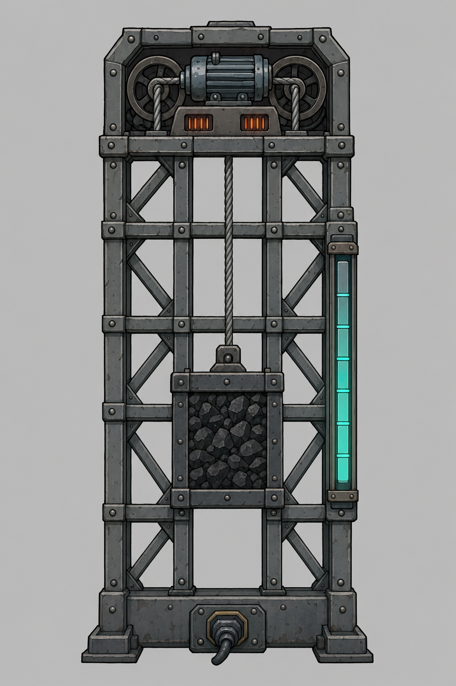

# Baterias Futuristas

Mod para Oxygen Not Included com baterias inspiradas em tecnologias reais. A primeira é a **bateria gravitacional**, uma torre que o jogador monta peça por peça e que guarda energia erguendo um peso.

Desenvolvido na build U59-744825. Está em desenvolvimento.



## Como montar

As peças ficam na aba Energia, depois de pesquisar Regulação Avançada de Energia.

1. Construa uma base no chão: a **Base da Bateria Gravitacional** ou a **Base Hidráulica Gravitacional**.
2. Empilhe **Trilhos Gravitacionais** sobre ela, sem espaços.
3. Coloque o **Motor Gravitacional** em cima do último trilho.
4. Ligue o fio no tile do meio da base.

Trilhos e motor só podem ser colocados sobre uma base ou outro trilho, alinhados.

## As duas bases

| | Base de peso | Base hidráulica |
| --- | --- | --- |
| Abastecimento | Duplicantes trazem sólidos escolhidos no filtro | Cano de líquido no tile esquerdo da base |
| Massa máxima (aço) | 16 t | 10 t |
| Massa máxima (ferro) | 8 t | 5 t |
| Massa máxima (outros metais) | 4 t | 3 t |

O metal da base também define a altura: 100 trilhos em aço, 50 em ferro e 20 nos demais.

## Como funciona

- **Capacidade:** massa × altura total, com cerca de 8,3 J por kg, por tile.
- **Parada:** não perde carga nem gera calor.
- **Perdas:** 5% ao carregar e 3% ao descarregar. A energia perdida vira calor no motor.
- **Potência:** o motor carrega a até 480 W.
- **Automação:** a base tem saída lógica e faixa de ativação, como a bateria inteligente do jogo.

## Aumentar ou consertar a torre

Desconstrua o motor, empilhe mais trilhos e recoloque o motor. A carga fica guardada enquanto a torre estiver incompleta, mas a bateria não aceita carga nova nesse período. Aparelhos ligados nela ainda podem consumir a energia guardada.

## Limitações conhecidas

- A base hidráulica ainda não tem saída por cano.
- O tanque aparece azul com qualquer líquido.
- O medidor desenhado nos trilhos é só visual e repete a cada peça.

## Compilar

É preciso ter o jogo instalado e o .NET SDK. Ajuste `GameManaged` em `BateriasFuturistas.csproj` para a pasta do seu jogo e rode:

```
dotnet build -c Release
```

O build instala o mod em `Documents\Klei\OxygenNotIncluded\mods\Local\BateriasFuturistas`. Depois, ative **Baterias Futuristas** no menu de mods.

## Testes automáticos

O mod tem um modo de teste que roda dentro do jogo. Ele abre uma cópia de um save, constrói as peças, faz as verificações, grava `autotest_result.txt` na pasta do mod e fecha o jogo. Com o jogo fechado, rode em um terminal Bash:

```
bash tools/run_autotest.sh "caminho/do/save.sav"
```

Ajuste `GAME_DIR` no script se o jogo estiver em outra pasta. O modo só fica ativo enquanto o arquivo `autotest.flag` existir na pasta do mod.

## Arte

As artes em `art/` foram geradas com IA. Para refazer as animações a partir delas, é preciso Python com Pillow:

```
python tools/make_structure_kanims.py .
```
