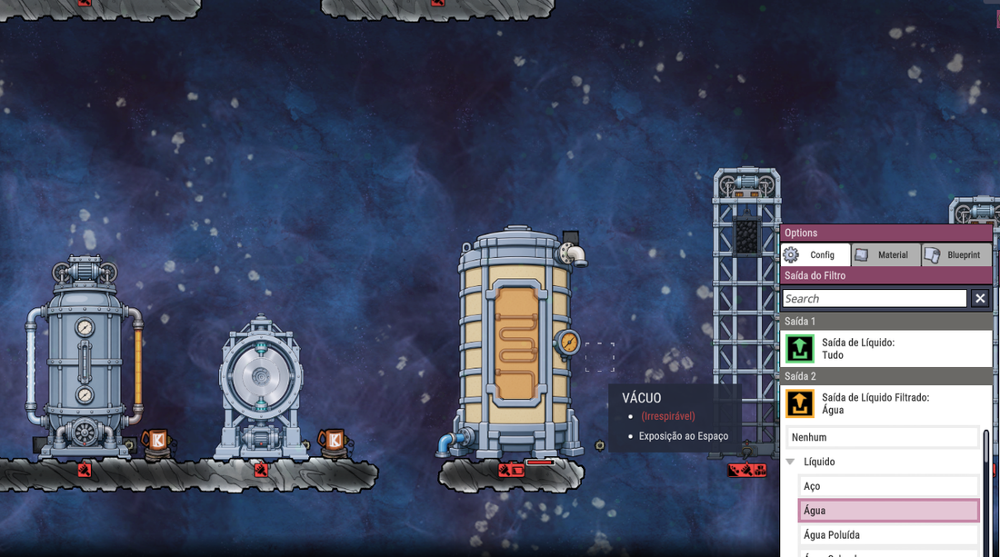
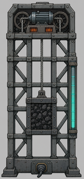
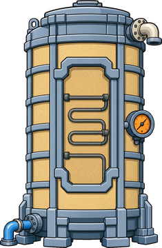
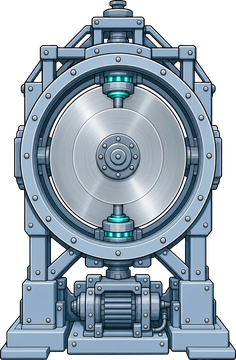
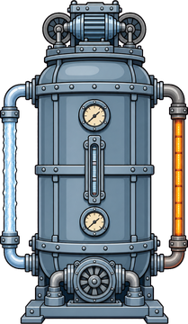
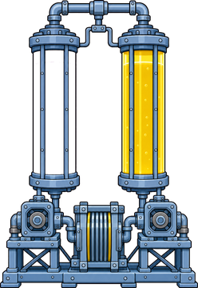
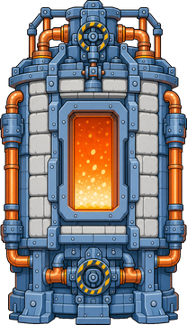
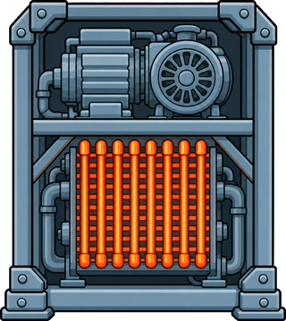

# Baterias Futuristas

Mod para **Oxygen Not Included** com seis formas de guardar energia inspiradas em tecnologias reais, e uma bomba de calor que usa os canos do próprio jogo.

Desenvolvido na build U59-744825. Está em desenvolvimento, e os valores ainda podem mudar com testes de equilíbrio.



## As baterias

| | Bateria | Tamanho | Capacidade máxima | Destaque |
| --- | --- | --- | --- | --- |
|  | **Gravitacional** | 3 de largura, altura montada | Massa × altura | Não perde carga parada |
|  | **Térmica de areia** | 5×8 | 30 t, cerca de 12 milhões de kDTU | Não perde calor e gera vapor |
|  | **Volante de inércia** | 4×5 | 300 kJ | Carga rápida, perde energia parado |
|  | **Ar comprimido** | 4×7 | 1.200 kJ | Esquenta ao carregar, esfria ao descarregar |
|  | **Fluxo líquido** | 6×8 | 3.600 kJ | Enche por cano |
|  | **Sal fundido** | 6×10 | 15.000 kJ | A maior do mod |

As baterias de carga elétrica têm saída de automação por nível de carga. Ar comprimido, fluxo líquido e a base hidráulica têm o botão **Drenar pelo cano**.

## Bateria gravitacional

A torre é montada peça por peça, na aba Energia, depois de pesquisar Regulação Avançada de Energia.

1. Construa uma base no chão: a **Base da Bateria Gravitacional**, abastecida por duplicantes, ou a **Base Hidráulica Gravitacional**, abastecida por cano.
2. Empilhe **Trilhos Gravitacionais** sobre ela, sem espaços.
3. Coloque o **Motor Gravitacional** em cima do último trilho.
4. Ligue o fio no tile do meio da base.

| Metal da base | Peso máximo | Tanque hidráulico | Trilhos máximos |
| --- | --- | --- | --- |
| Aço | 16 t | 10 t | 100 |
| Ferro | 8 t | 5 t | 50 |
| Outros | 4 t | 3 t | 20 |

- **Capacidade:** cerca de 8,3 J por kg, por tile de altura.
- **Perdas:** 5% ao carregar e 3% ao descarregar, viradas em calor no motor.
- **Potência:** 480 W em uma torre de 6 tiles, crescendo com a altura.
- **Aumentar a torre:** desconstrua o motor, empilhe mais trilhos e recoloque o motor. A carga fica guardada durante a obra.

## Bateria térmica de areia

Aquece a areia com eletricidade e usa esse calor para transformar água em vapor. Libera com a pesquisa Modulação de Temperatura.

- **Conexões:** fio no tile do meio da base, água no tile esquerdo da base e vapor no tile direito do topo.
- **Aquecedor:** 2 kW, até 500 °C.
- **Vapor:** começa quando a areia passa de 150 °C.
- **Automação:** a entrada liga ou para o aquecedor, e a saída fica verde dentro de uma faixa de temperatura ajustável.

## Bomba de calor

 

Duas peças, na aba Utilitários, ligadas pelos canos do jogo:

| Peça | Entra | Sai | Energia |
| --- | --- | --- | --- |
| **Compressor de Calor** (2×2) | Gás | Líquido, até 1 kg/s | 1.200 W |
| **Válvula de Expansão** (1×2) | Líquido | Gás muito frio, 0,2 kg/s | Não usa |

O calor retirado do gás e a energia gasta saem no compressor. Use **canos isolados** entre o compressor e a válvula, porque em cano comum o líquido esquenta acima do ponto de ebulição.

Resfriamento de uma válvula, com ambiente a 20 °C: hidrogênio 130 kDTU/s, metano 79, gás ácido 68, oxigênio 40, propano 29, dióxido de carbono 11 e cloro 5.

## Limitações conhecidas

- O sal não solidifica se esfriar.
- A base de peso e as baterias de areia e sal não têm saída por cano.
- O tanque hidráulico aparece azul com qualquer líquido.
- Saves com peças do mod dependem dele instalado.

## Compilar

É preciso ter o jogo instalado e o .NET SDK. Ajuste `GameManaged` em `BateriasFuturistas.csproj` para a pasta do seu jogo.

- `dotnet build -c Dev` compila com o modo de teste e instala em `Documents\Klei\OxygenNotIncluded\mods\Local\BateriasFuturistas`. Depois, ative **Baterias Futuristas** no menu de mods.
- `dotnet build -c Release` compila sem o modo de teste e gera em `publish/BateriasFuturistas` a pasta limpa para publicar.

## Testes automáticos

Só a compilação Dev inclui o modo de teste, que roda dentro do jogo. Ele abre uma cópia de um save, constrói as peças, faz as verificações, grava `autotest_result.txt` na pasta do mod e fecha o jogo. Com o jogo fechado, rode em um terminal Bash:

```
bash tools/run_autotest.sh "caminho/do/save.sav"
```

Ajuste `GAME_DIR` no script se o jogo estiver em outra pasta.

## Traduções

O texto padrão é em inglês. As traduções ficam em `mod/translations/<idioma>.po`, no formato usado pelo jogo. Já existe `pt_BR.po`.

## Arte

As artes em `art/` foram geradas com IA. Para refazer as animações a partir delas, é preciso Python com Pillow:

```
python tools/make_structure_kanims.py .
```
